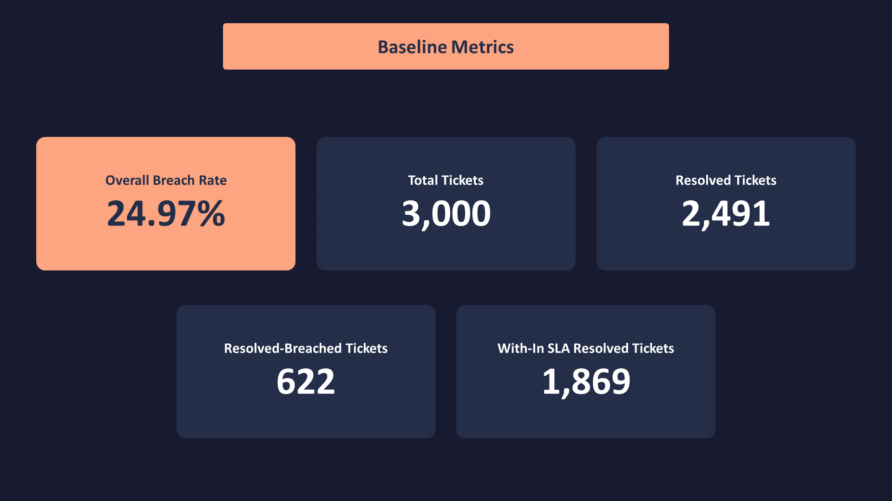
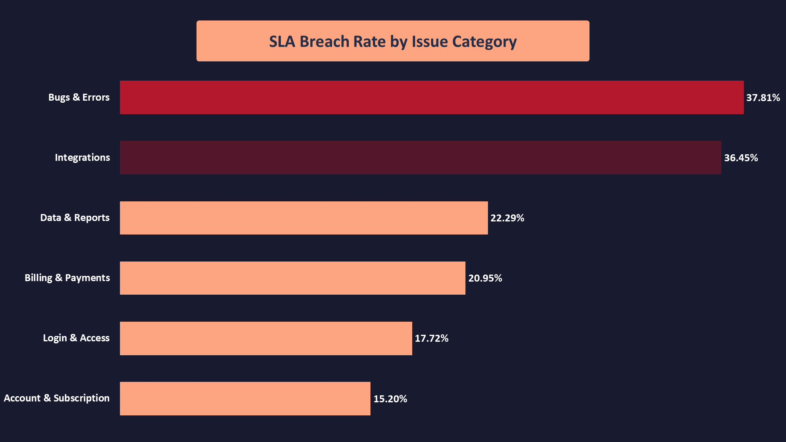
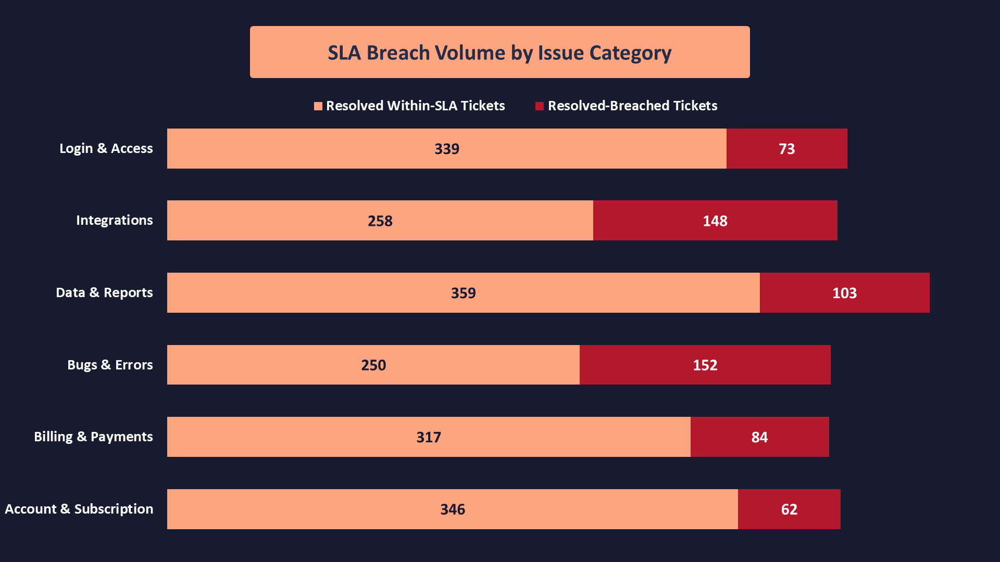
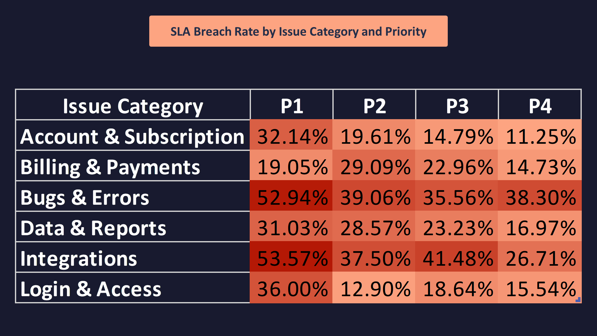
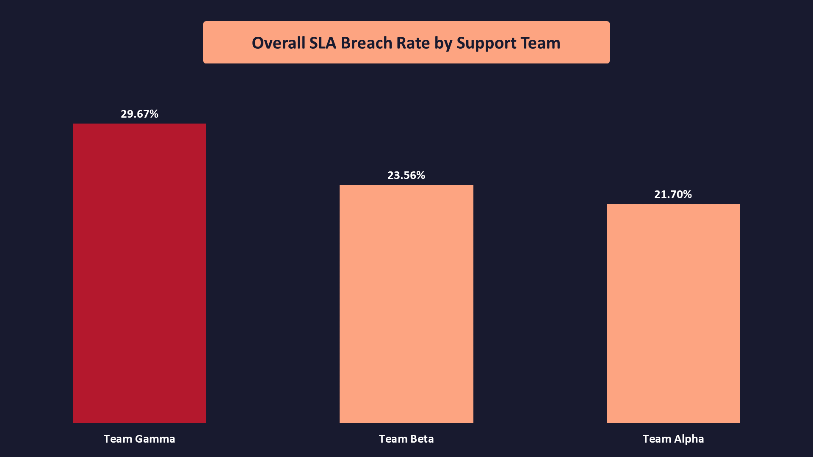
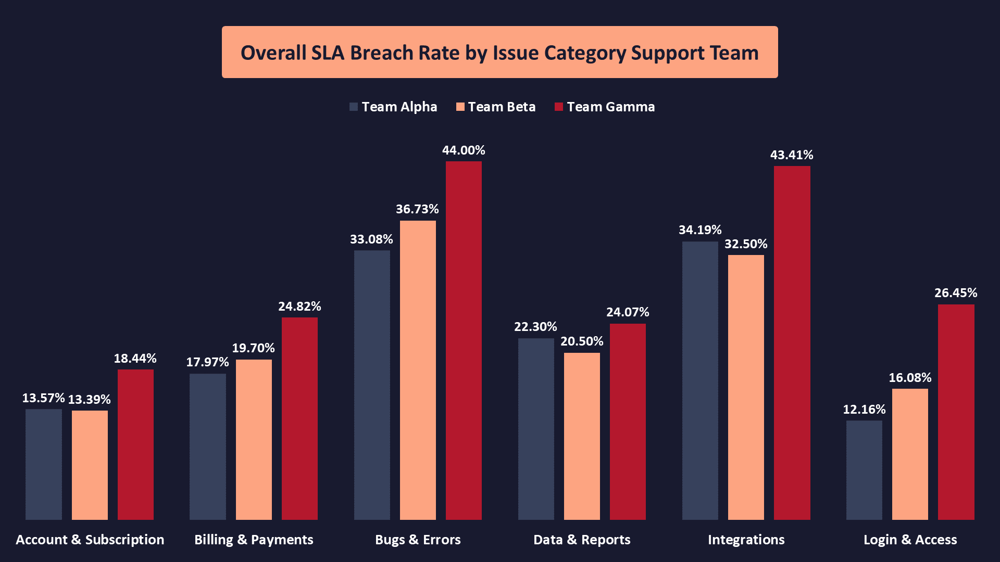

# **SaaS Support SLA Performance Analysis**
## **One Question Projects — Project 06**

## **Project Overview**
This project analyzes customer support ticket resolution performance in a simulated SaaS environment, focusing on Service Level Agreement (SLA) compliance.

Using a dataset of 3,000 support tickets, the analysis examines resolution outcomes against defined SLA targets to identify patterns in SLA breaches across issue categories and operational dimensions.

The project follows a structured analytics workflow, from data quality assessment and transformation using Excel Power Query to KPI development and analysis using the Excel Data Model, Power Pivot, and PivotTables.

## **Business Problem**
SaaS companies rely on customer support teams to resolve issues within defined service targets. However, differences in issue complexity, ticket priority, and operational workload may contribute to inconsistent resolution performance.

Without a structured analysis of support ticket data, management may struggle to identify which issue categories experience the highest rates of SLA breaches and where further operational investigation is needed.

This limits the ability to prioritize improvement efforts and investigate the factors contributing to delayed ticket resolution.

## **Project Goal**
The goal of this project is to evaluate customer support resolution performance by measuring SLA compliance and comparing breach rates across issue categories.

The analysis aims to identify the categories that warrant further investigation, supported by ticket volumes and relevant operational indicators, to help management prioritize potential areas for improvement.

The analysis will focus on resolved tickets when calculating the primary SLA breach rate, while open and cancelled tickets will be handled separately according to their status.

## **Project Business Question**
**Which customer support issue categories have the highest SLA breach rates, and where should management prioritize further investigation?**

## Executive Summary
**No Summary Yet — To Be Completed After Analysis.**

## **Dataset Description**
The dataset contains **3,000** support tickets simulated for a SaaS company operating in the software services industry. It consists of **13** columns covering ticket creation and resolution timestamps, issue categories, ticket priorities, support channels, support teams, customer subscription plans, response and resolution times, and Service Level Agreement (SLA) compliance status.

The dataset supports the analysis of SLA Breach Rate across different support issue categories, helping identify categories with elevated breach rates and determine where management should prioritize further operational investigation.

| Column | Description |
| ------ | ----------- |
| ticket_id | Unique identifier assigned to each support ticket. |
| created_at | Date and time when the support ticket was created. |
| resolved_at | Date and time when the ticket was resolved, where applicable. |
| issue_category | Category of the issue reported, such as billing and payments, login and access, or bugs and errors. |
| priority | Priority level assigned to the ticket, ranging from P1 (highest priority) to P4 (lowest priority). |
| channel | Channel through which the ticket was submitted, such as email, live chat, web form, or in-app support. |
| support_team | Support team responsible for handling the ticket. |
| customer_plan | Subscription plan associated with the customer, such as Free, Basic, Professional, or Enterprise. |
| status | Current ticket status, recorded as Resolved, Open, or Cancelled. |
| first_response_minutes | Time elapsed, in minutes, before the support team provided the first response. |
| resolution_minutes | Time elapsed, in minutes, between ticket creation and resolution, where applicable. |
| sla_target_hours | Target resolution time, in hours, assigned to the ticket based on its priority level. |
| sla_status |	SLA compliance classification of the ticket, indicating whether it was resolved within the target, breached the target, remains open and overdue, is pending within the target, or was cancelled. |

## **EDA & Baseline KPIs**
An initial exploratory analysis was conducted to validate the dataset structure, review SLA status distributions, and establish baseline performance metrics. Out of **3,000** support tickets, **2,491** were resolved, with **622** breaching their SLA targets, resulting in an **overall SLA breach rate of 24.97%**. A preliminary comparison across issue categories identified Bugs & Errors and Integrations as the categories with the highest SLA breach rates and the largest numbers of breached tickets, highlighting them as priority areas for further investigation.

## **Analysis**
**The analysis focused on comparing SLA breach rates across support issue categories, ticket priorities, and support teams to identify performance gaps and determine where management should prioritize further investigation. Additional comparisons examined breach volumes alongside breach rates to distinguish high ticket volumes from categories and teams experiencing disproportionately high SLA breach rates.**

### **Bseline Metrics**

- The dataset contains **3,000 total tickets**, of which **2,491 were resolved**. Among the resolved tickets, **622 breached their SLA targets**, while **1,869 were resolved within SLA**, resulting in an overall SLA breach rate of **24.97%**.

### **SLA Breach Rate by Issue Category**

- **Bugs & Errors recorded** the highest SLA breach rate at **37.81%**, followed by **Integrations** at **36.45%**.
- **Account & Subscription** recorded the lowest breach rate at **15.20%**, a **22.61 percentage-point** gap compared with **Bugs & Errors**.
- - **Both Bugs & Errors and Integrations** exceeded the overall breach rate of **24.97%**, highlighting them as priority areas for further investigation.

### **SLA Breach Volume by Issue Category**

- **Bugs & Errors** and Integrations accounted for **300 of the 622** SLA breaches (**48.2%**), despite representing only **32.4%** of all resolved tickets. This indicates that SLA breaches are disproportionately concentrated in these two issue categories.
- **Bugs & Errors** recorded **152** breached tickets, followed closely by **Integrations** with **148**. Together, these categories represent **nearly half of all resolved-ticket SLA breaches**, reinforcing their priority for further operational investigation.

### **SLA Breach Rate by Issue Category and Priority**

- **P3 tickets accounted for the highest numbers of resolved tickets and SLA breaches across all six issue categories. However, the highest breach volume did not translate into the highest breach rate, highlighting the importance of distinguishing ticket volume from relative SLA risk**.
- **P1** recorded the highest SLA breach rate in five of the six issue categories. **Billing & Payments** was the only exception, where **P2** had the highest breach rate at **29.09%**, compared with **19.05%** for **P1**.

### **Overall SLA Breach Rate by Support Team**

- **Team Gamma** recorded the highest overall SLA breach rate at **29.67%**, compared with **23.56%** for **Team Beta** and **21.70%** for **Team Alpha**. **Gamma** accounted for **39.1%** of all SLA breaches, despite handling **32.9%** of resolved tickets, making it the primary support team for further investigation.

### **SLA Breach Rate by Issue Category and Support Team**

- **Team Gamma recorded the highest SLA breach rate across all six issue categories**, including **44.00%** for **Bugs & Errors** and **43.41%** for **Integrations**. This consistent pattern indicates that **Gamma's elevated breach rate extends across different issue categories**, making the team a key priority for further operational investigation.

> Overall, the analysis identified **Bugs & Errors** and **Integrations** as the **highest-breach** issue categories, **P1** as the priority with **the highest breach rate** in most categories, and **Team Gamma as the team with consistently elevated breach rates**. These findings establish clear priorities for further investigation, although additional analysis would be required to determine the underlying causes of SLA breaches.

## **Conclusion**
The analysis revealed an **overall SLA breach rate of 24.97%** across **2,491 resolved support tickets**. **Bugs & Errors and Integrations** recorded **the highest breach rates** and together accounted for **48.2%** of all SLA breaches. While **P3** tickets generated the largest breach volumes, **P1** had the highest breach rate in five of the six issue categories. **Team Gamma** showed the most consistent performance concern, recording **the highest overall breach rate** and **the highest rate within every issue category**. These findings identify clear priorities for further operational investigation, although the underlying causes of SLA breaches remain undetermined.

## **Recommendations**
- **Investigate Bugs & Errors and Integrations**: Review ticket complexity, recurring technical issues, resolution workflows, and resource availability to understand why these categories have elevated breach rates.
- **Review Team Gamma's performance**: Examine workload distribution, ticket assignment practices, staffing, and resolution processes. Compare its practices with those of Teams Alpha and Beta to identify potential operational differences.
- **Review P1 and P3 tickets separately**: Investigate why P1 tickets have higher breach rates across most categories, while P3 tickets account for the largest number of breaches. This can help distinguish high-risk tickets from high-volume workload.
- **Monitor SLA performance regularly**: Track breach rates and breach volumes by issue category, priority, and support team. Use consistent definitions and resolved-ticket denominators to identify deterioration and evaluate whether corrective actions improve performance.
- **Conduct a follow-up root-cause analysis**: After reviewing the priority areas, examine relevant factors such as ticket complexity, assignment history, response delays, and resolution time to determine the drivers of SLA breaches before implementing targeted operational changes.

## **Tools Used**
- **`Microsoft Excel`**: Data analysis, PivotTables, and analytical calculations.
- **`Power Query`**:  Data preparation and transformation.
- **`DAX (Data Analysis Expressions)`**: Creating measures for SLA performance metrics.
- **`Microsoft PowerPoint`**: Chart design and visual presentation of analytical findings.
- **`Git / GitHub`**: Project version control and repository management